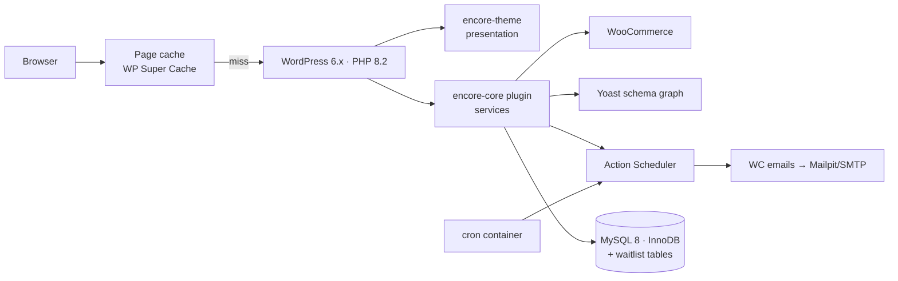

# Encore Live

A production-style **WordPress + WooCommerce ticketing portal** for *Encore Live*, a fictional Dubai promoter of stand-up comedy and live music. Fans browse shows, artists and venues, buy tiered tickets, and join a first-come waitlist when a show sells out. When tickets come back, the site emails them automatically, in order.

> Portfolio project. Encore Live, every artist and every venue are invented. Artwork is generated in code.

**Status:** all 9 phases complete (PRs #1–#9). Lighthouse mobile **100** on the home, archive and show pages. Every number in this repo comes from a saved report or test run.

## Features

- **Content model.** Shows, artists and venues as custom post types; genre and city taxonomies; native OOP meta boxes (nonce + capability + sanitizers); typed, REST-exposed post meta.
- **Custom theme.**
  - Dark, mobile-first, classic PHP theme with accessible markup (Lighthouse a11y 100) and RTL-ready logical CSS.
  - Shows A–Z mega-menu, plugin-free archive filters (`pre_get_posts`), a sticky mobile "Get tickets" bar.
  - Elementor-compatible: full-width template, header/footer locations.
- **Ticketing.**
  - A variable product per show, where each Tier variation's stock is that tier's capacity.
  - Server-side purchase rules at all 4 cart entry points (per-order limit, cancelled, ended and sold-out shows).
  - A validated UAE attendee phone on the **block** checkout (Additional Checkout Fields API).
  - Ticket details on cart, emails and accounts. Show status follows stock, including refunds.
- **Sold-out waitlist.**
  - Double opt-in with hashed single-use tokens; honeypot plus a hashed-IP rate limit.
  - Versioned custom MySQL tables with an audit log, and transactional state changes (`SELECT … FOR UPDATE`).
  - Action Scheduler jobs: FIFO "skip-and-continue" batches, 24 h signed claim links that pre-fill the cart, and conversion tracking.
  - 3 WooCommerce email classes.
  - A `WP_List_Table` admin screen with masking, bulk actions, a `GROUP BY` summary and streamed CSV.
  - Privacy exporter and eraser.
- **Integrations.** Two shortcodes, a cached renderer, a read-only REST API (`encore/v1`) with schemas and pagination headers, and an Elementor widget, all sharing one query builder.
- **SEO.**
  - Event JSON-LD inside Yoast's schema graph; Yoast configured in code.
  - `noindex` on filtered archives; a daily archive job with **301**s to the artist; sitemap exclusion.
- **Analytics.** GA4 e-commerce events through a settings-driven GTM container. `purchase` fires once per order behind an order-key check.
- **Performance.**
  - Page cache with purging on stock changes; critical CSS inline; WooCommerce/jQuery off non-shop pages.
  - Self-hosted font, WebP, right-sized images. TTFB ~1 s → ~10 ms.
- **Hardening.** Server-level security headers (cached pages too), XML-RPC and user enumeration blocked, file editing disabled.

## Architecture


More diagrams (waitlist flows, Docker services): [`docs/ARCHITECTURE.md`](docs/ARCHITECTURE.md). Plugin ↔ theme ↔ API contract: [`docs/INTEGRATION_CONTRACT.md`](docs/INTEGRATION_CONTRACT.md).

## Setup (Windows PowerShell; WSL/macOS use `make` or `scripts/encore.sh`)

Needs Docker Desktop (WSL2) and Git.
```powershell
git clone https://github.com/sarvagyajain299/encore-live.git
cd encore-live
.\scripts\encore.ps1 up        # creates .env, builds and starts the stack
.\scripts\encore.ps1 install   # WordPress, plugins, store, SEO and cache config
.\scripts\encore.ps1 seed      # demo artists, venues, shows and ticket products
.\scripts\encore.ps1 demo      # optional: shortcode page + Elementor page
```

| URL | |
|---|---|
| http://localhost:8080 | Site (admin at `/wp-admin`, credentials in `.env`) |
| http://localhost:8025 | Mailpit: every email the site sends |
| http://localhost:8081 | phpMyAdmin |

Commands: `up`, `down`, `install`, `seed [--force]`, `reset`, `demo`, `wp <args>`, `composer <args>`, `phpcs`, `phpcbf`, `test`, `shell`, `destroy`.

## Tests and quality

| Suite | Command | Last result (2026-11-18) |
|---|---|---|
| Everything below, freshly seeded each time | `.\scripts\qa.ps1` | see [`docs/QA.md`](docs/QA.md) |
| PHPCS (WordPress Coding Standards + PHP 8.2 compatibility) | `.\scripts\encore.ps1 phpcs` | 0 errors, 0 warnings |
| Unit tests (PHPUnit 11 + Brain Monkey) | `.\scripts\encore.ps1 test` | OK (138 tests, 262 assertions) |
| Ticketing E2E (Store API) | `.\scripts\smoke-ticketing.ps1` | 12 / 12 |
| Waitlist E2E (REST + Mailpit) | `.\scripts\smoke-waitlist.ps1` | 32 / 32 |
| REST, shortcodes, Elementor | `.\scripts\smoke-api.ps1` | 14 / 14 |
| SEO | `.\scripts\smoke-seo.ps1` | 21 / 21 |
| Security | `.\scripts\smoke-security.ps1` | 12 / 12 |
| Browser purchase journey (Playwright) | `cd tests\e2e; npm install; npx playwright test` | 1 / 1 |
| GA4 dataLayer journey (Puppeteer) | `cd tests\e2e; npm run analytics` | 11 / 11 |
| Lighthouse mobile (median of 3) | `.\scripts\lighthouse.ps1 -Label x -Lighthouse <path>` | 100 / 100 / 100 performance; see [`docs/PERFORMANCE.md`](docs/PERFORMANCE.md) |

## Screenshots to capture
1. Home page, desktop and phone
2. Shows archive with filters applied, and the A–Z menu open
3. Show page with the tier selector, and the sticky mobile bar
4. Sold-out show with the waitlist form
5. Cart and checkout with ticket details and the attendee phone field
6. The three waitlist emails in Mailpit
7. Encore → Waitlists (admin, then editor with masked emails)
8. Lighthouse after-reports, plus the Rich Results Test result
9. GTM Preview / DevTools showing the `purchase` dataLayer event

## Docs
[Architecture](docs/ARCHITECTURE.md) · [Integration contract](docs/INTEGRATION_CONTRACT.md) · [SEO](docs/SEO.md) · [Analytics](docs/ANALYTICS.md) · [Performance](docs/PERFORMANCE.md) · [Security](docs/SECURITY.md) · [QA](docs/QA.md) · [Interview notes](docs/INTERVIEW_NOTES.md) · [CV bullets](docs/CV_BULLETS.md) · [Your TODOs](docs/TODOS.md) · [PR notes](docs/prs/)

## What I'd do next
1. **Real seat holds** for waitlist claims: a holds table, stock decremented on claim, released by a scheduled job, converted at checkout (design in the Phase 5 notes).
2. **Per-customer purchase limits** across orders (by email/account) and a queue page for high-demand on-sales.
3. **Redis object cache** and Nginx serving supercache files directly on the VPS, plus Cloudflare edge caching with cart/login bypass.
4. **Content-Security-Policy** with nonces (Report-Only first), Consent Mode v2 with a CMP, HSTS.
5. **Arabic (RTL) version:** WPML/Polylang, `.po` translations, and Arabic fonts (the theme already uses logical CSS).
6. **CI:** GitHub Actions running PHPCS, PHPUnit and the smoke tests against a Dockerised stack on every PR; Lighthouse CI budgets.
7. **Seat maps** for seated venues, and QR e-tickets with door scanning (signed ticket IDs).
