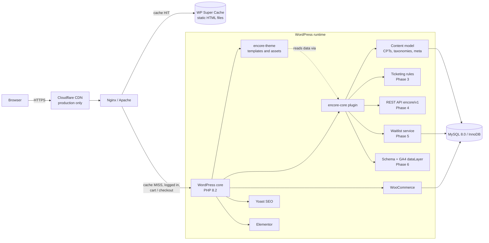
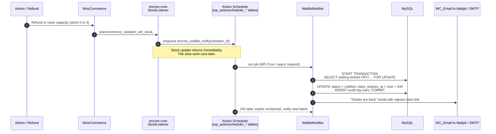
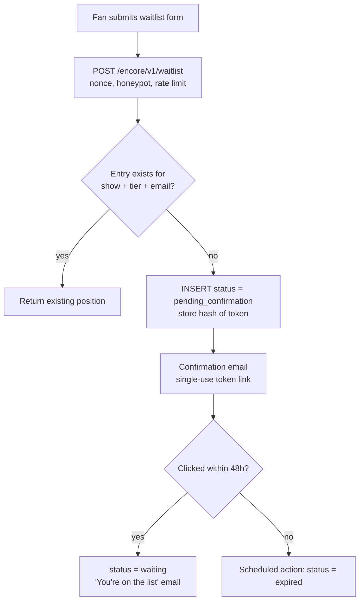
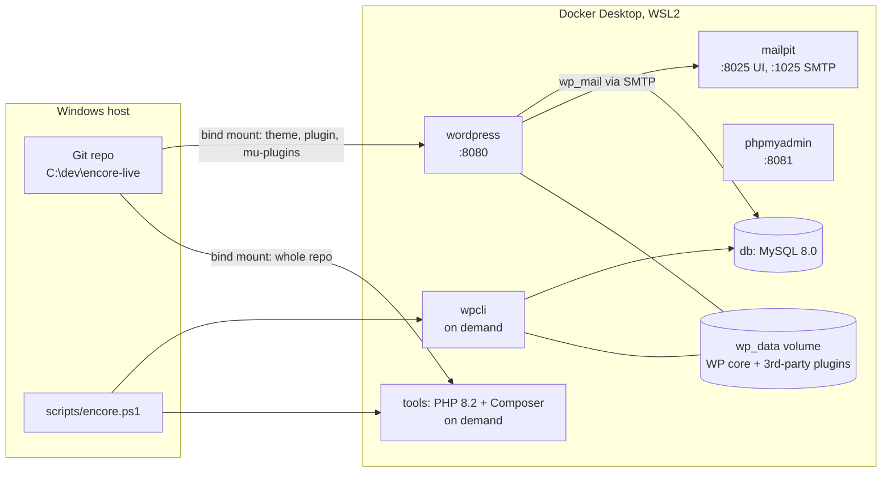

# Architecture

This page shows the planned target architecture. Parts marked *(Phase N)* do not exist yet.

## 1. Request flow

**Rule:** the theme renders. The plugin decides. If you switch the theme off, every show, rule and waitlist entry still exists.

## 2. Restock → waitlist notification (Phase 5)

## 3. Waitlist double opt-in email flow (Phase 5)

## 4. Local development environment (Phase 0)

| Service | Image | Why |
|---|---|---|
| `wordpress` | `wordpress:php8.2-apache` | Official image. Builds `wp-config.php` from environment variables, so there are no secrets in files. |
| `db` | `mysql:8.0` | Same engine as production. InnoDB gives transactions for the waitlist. |
| `phpmyadmin` | `phpmyadmin:5.2` | Look inside custom tables while developing. |
| `mailpit` | `axllent/mailpit` | Catches every email. No real email can escape a dev machine. |
| `wpcli` | `wordpress:cli-php8.2` | Scripted, repeatable install. Runs as uid 33 to match Apache's `www-data`. |
| `tools` | `docker/tools/Dockerfile` | PHP 8.2 + Composer for PHPCS and PHPUnit. You don't need PHP on Windows. |
